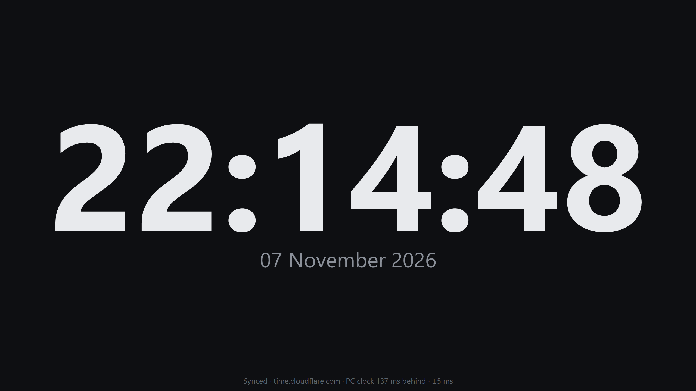

# Time ISN't

A tiny, dark, full-screen clock for Windows, synced to internet time.
Written in x64 Assembly: one 28 KB `.exe`, nothing to install.

## Download

Get `TimeIsnt.exe` from the [latest release](../../releases/latest) and run it.
That one file is the whole program.

**Needs:** 64-bit Windows 10 (version 1703 or newer) or Windows 11.
Windows may show "Windows protected your PC" the first time, because the file
isn't signed: click **More info → Run anyway**.

## Features

- **Synced time.** Asks internet time servers (Cloudflare, Google, Microsoft,
  pool.ntp.org) for the exact time and corrects your PC's clock error. Re-syncs every
  15 minutes, after sleep and when the Windows clock changes. The status line
  shows how far off your PC is, e.g. *PC clock 125 ms behind · ±5 ms*.
- **Full screen** with the mouse pointer hidden; the screen stays awake.
- **Dark theme**, smooth anti-aliased digits at any size, no flicker.
- **Date in your Windows language.**
- **Very light:** about 0.2% of one CPU core and 3 MB of its own memory in full
  screen at 2560×1440. It wakes once per second and redraws only the digits that changed.

## Keys

| Key | Action |
|---|---|
| **F11**, **F** or double-click | Toggle full screen |
| **Esc** | Leave full screen |
| **S** | Sync with time servers now |

## Build from source

1. Download flat assembler 1.73 for Windows from
   [flatassembler.net](https://flatassembler.net/download.php) and unzip it so that
   `tools\fasm\FASM.EXE` exists.
2. Run `build.bat`. It writes `TimeIsnt.exe`.

To change the icon, edit and run `icon\make_icon.ps1`, then build again.
Colours, font weight and sync timing are named constants at the top of `clock.asm`.

## Files

| Path | What it is |
|---|---|
| `clock.asm` | The whole program |
| `build.bat` | Builds `TimeIsnt.exe` with FASM |
| `icon/` | Icon images and the script that draws them |
| `comparison/clock.py` | The same clock in Python, used to compare speed and memory |
